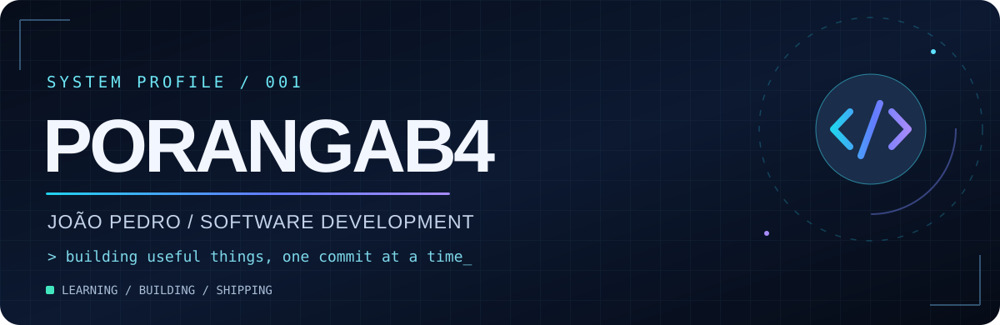
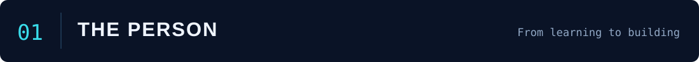
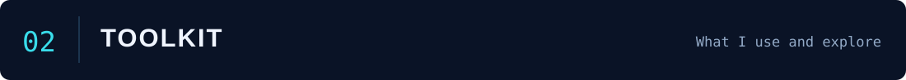
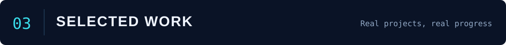
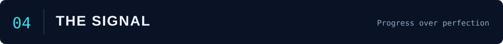
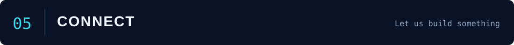

<div align="center">



<br/>

[](https://github.com/Porangab4)
[](https://www.linkedin.com/in/joao-pedro-porangaba/)
[](mailto:jpporangaba@gmail.com)

**`PYTHON`** &nbsp; • &nbsp; **`SOFTWARE DEVELOPMENT`** &nbsp; • &nbsp; **`PROBLEM SOLVING`**

</div>

<br/>



### Olá, eu sou o João Pedro 👋

Sou estudante de **Desenvolvimento de Sistemas na ETEC**, com foco em transformar o que aprendo em projetos funcionais. Gosto de entender a lógica por trás de cada solução, testar ideias e melhorar meu código a cada versão.

```python
class Developer:
    name = "João Pedro"
    username = "Porangab4"
    focus = ["Python", "Software Development", "Problem Solving"]
    mindset = "learn → build → test → improve"
```

- 🎓 **Formação:** Técnico em Desenvolvimento de Sistemas — ETEC (em andamento)
- 🧠 **Atualmente:** Python, lógica de programação, desenvolvimento de sistemas e ferramentas web
- 🎯 **Próximo passo:** oportunidade de estágio para aplicar e ampliar meus conhecimentos

<br/>



<div align="center">

**Linguagens e ferramentas que utilizo / estudo**


<br/><br/>

**Tecnologias que exploro em projetos**


</div>

<sub>As ferramentas representam diferentes níveis de experiência e estudo — não certificações de proficiência.</sub>

<br/><br/>



<div align="center">
<table>
<tr><td width="50%" valign="top">
<h3>💧 Controle de Níveis de Água</h3>
<p>Simulação de monitoramento de reservatório com alertas visuais por nível.</p>
<p><code>Python</code> <code>Colorama</code></p>
<a href="https://github.com/Porangab4/controle-niveis-agua"><b>Explorar projeto ↗</b></a>
</td><td width="50%" valign="top">
<h3>💸 Controle Financeiro</h3>
<p>Registro de entradas, despesas, saldo e histórico com persistência de dados.</p>
<p><code>Python</code> <code>JSON</code></p>
<a href="https://github.com/Porangab4/controle-financeiro-python"><b>Explorar projeto ↗</b></a>
</td></tr>
<tr><td width="50%" valign="top">
<h3>📊 Pesquisa de Opinião</h3>
<p>Contagem e processamento de respostas utilizando estruturas de repetição.</p>
<p><code>Python</code> <code>Loops</code></p>
<a href="https://github.com/Porangab4/pesquisa-opiniao"><b>Explorar projeto ↗</b></a>
</td><td width="50%" valign="top">
<h3>⚡ Consumo de Energia</h3>
<p>Projeto de lógica de programação aplicado à análise de consumo.</p>
<p><code>Python</code> <code>Logic</code></p>
<a href="https://github.com/Porangab4/consumo-energia"><b>Explorar projeto ↗</b></a>
</td></tr>
<tr><td width="50%" valign="top">
<h3>🚰 Consumo de Água</h3>
<p>Exercício de programação voltado à classificação e análise de consumo.</p>
<p><code>Python</code> <code>Conditions</code></p>
<a href="https://github.com/Porangab4/consumo-agua"><b>Explorar projeto ↗</b></a>
</td><td width="50%" valign="top">
<h3>🧩 Outros experimentos</h3>
<p>Exercícios, desafios e novas ideias publicados conforme evoluo.</p>
<p><code>Learning</code> <code>Building</code></p>
<a href="https://github.com/Porangab4?tab=repositories"><b>Todos os repositórios ↗</b></a>
</td></tr>
</table>
</div>

<br/>



<div align="center">


<br/>


<sub>Gráficos dinâmicos de serviços externos; podem ficar temporariamente indisponíveis.</sub>

</div>

<br/>



<div align="center">

### Tem uma ideia, projeto ou oportunidade?

**Estou aberto a trocar experiências, colaborar e aprender com novos desafios.**

[](https://www.linkedin.com/in/joao-pedro-porangaba/)
[](mailto:jpporangaba@gmail.com)

<br/>


<sub>PORANGAB4 // BUILT WITH CURIOSITY · UPDATED 2026</sub>

</div>
